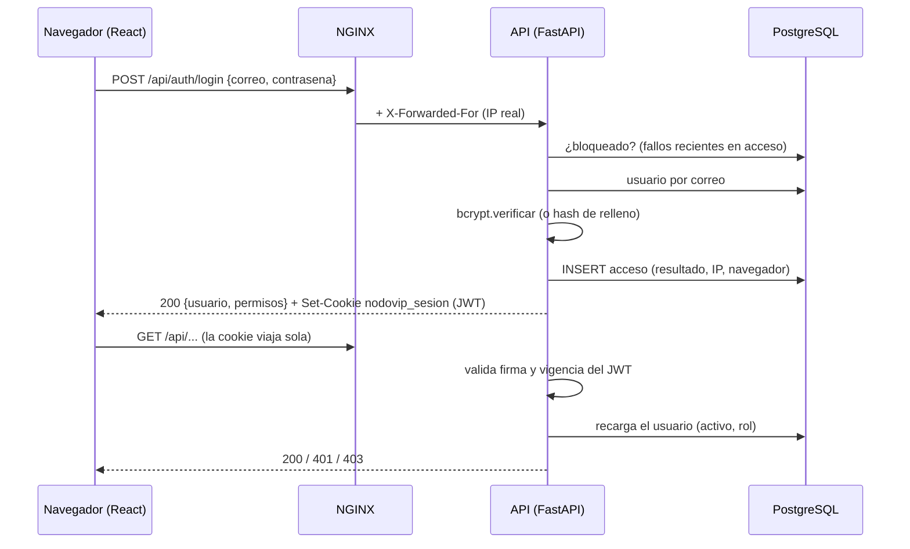

# Autenticación y acceso por rol (PB-01 · PC-12)

Login con correo y contraseña, sesión por cookie, control de acceso por permisos
(RNF-01) e historial de accesos.

## Flujo



## Sesión

| Aspecto | Decisión | Por qué |
|---|---|---|
| Token | JWT HS256 con solo `sub` (id de usuario), `iat` y `exp` | El rol no viaja en el token |
| Vigencia | 8 horas | Una jornada de ejercicio |
| Transporte | Cookie `nodovip_sesion`, `HttpOnly`, `SameSite=Strict`, `Path=/`, `Secure` fuera de local/test | El JavaScript no puede leerla (XSS) y no viaja en peticiones de otros sitios (CSRF). El WebSocket de PB-07 la recibe igual |
| Validación | En cada request se valida el token y **se recarga el usuario** | Desactivar una cuenta o cambiarle el rol aplica de inmediato |
| Cierre | `POST /api/auth/logout` borra la cookie | El token no se revoca en el servidor: si alguien lo copió, sirve hasta que venza o la cuenta se desactive |

## Seguridad del login

- **Mismo mensaje en todos los fallos:** "Correo o contraseña incorrectos" si el
  correo no existe, la contraseña es incorrecta o la cuenta está inactiva. El
  motivo real queda solo en el historial.
- **Mismo tiempo de respuesta:** con un correo inexistente se verifica igual
  contra un hash bcrypt de relleno.
- **Bloqueo por fuerza bruta:** tras **5 fallos** consecutivos con el mismo
  correo en **15 minutos** se responde `429` con `Retry-After: 900` y se
  registra `bloqueado`. Un acceso exitoso reinicia el conteo. Los intentos
  durante el bloqueo no lo alargan, pero tampoco lo acortan.
  - Limitación conocida: es por correo, así que alguien podría bloquear a
    propósito una cuenta ajena durante 15 minutos. El límite por IP queda para
    PB-16 (pruebas de seguridad).
- **IP del cliente:** NGINX **reemplaza** `X-Forwarded-For` por la IP que ve, y
  uvicorn lo acepta por `FORWARDED_ALLOW_IPS="*"` (docker-compose). Como el
  backend no se publica fuera de NGINX en staging/Demo, el cliente no puede
  falsear su IP. En local el puerto 8000 sí está expuesto.

## Configuración

| Variable | Obligatoria | Uso |
|---|---|---|
| `JWT_SECRETO` | Fuera de `local`/`test` (mín. 32 caracteres) | Firma de los tokens. Si falta, el backend **no arranca** |
| `COOKIE_SEGURA` | No | Vacío = automático (`Secure` fuera de local/test). `false` solo si la VM aún no tiene HTTPS |
| `APP_ENV` | Sí | Si no está definida se asume un servidor real (opción segura) |

Generar un secreto: `python -c "import secrets; print(secrets.token_urlsafe(48))"`.

## Endpoints

| Método | Ruta | Permiso | Respuestas |
|---|---|---|---|
| POST | `/api/auth/login` | — | `200` usuario + permisos y cookie · `401` credenciales · `422` cuerpo inválido · `429` bloqueado |
| POST | `/api/auth/logout` | — | `204` y borra la cookie |
| GET | `/api/auth/yo` | sesión | `200` usuario + permisos · `401` |
| GET | `/api/accesos?usuario_id=&q=&resultado=&desde=&hasta=&limite=` | usuarios:gestionar | Historial, más reciente primero (máx. 1000, 200 por defecto) |

Los demás endpoints no cambiaron: siguen usando `requiere_permiso(...)`, que
ahora obtiene el usuario de la cookie. La cabecera temporal `X-Rol-Debug` ya no existe.

```bash
# Probar con curl (guarda la cookie en un archivo)
curl -c sesion.txt -H "Content-Type: application/json" \
  -d '{"correo":"admin@ejemplo.test","contrasena":"..."}' \
  http://localhost:8080/api/auth/login
curl -b sesion.txt http://localhost:8080/api/escenarios
```

## Historial de accesos (tabla `acceso`, migración 0003)

Cada intento de login, exitoso o no: usuario (si el correo existe), correo
ingresado, fecha/hora, IP, navegador y resultado (`exitoso`,
`credenciales_invalidas`, `usuario_inactivo`, `bloqueado`). Se consulta en
**Historial de accesos** (menú del Administrador) o desde **Accesos** en cada
fila de Gestión de usuarios.

La FK a `usuario` es `RESTRICT`: una cuenta que alguna vez ingresó ya no se
puede eliminar, solo desactivar (la API responde 409), para no perder la auditoría.

## Frontend

- `SesionProvider` consulta `/auth/yo` al abrir la app y expone `useSesion()`
  (`usuario`, `puede(permiso)`, `iniciarSesion`, `cerrarSesion`).
- Los atajos (`puedeLeerEscenarios`, `puedeGestionarEscenarios`,
  `puedeGestionarUsuarios`) salen de los **permisos que devuelve el backend**,
  no del nombre del rol.
- `RutaProtegida`: sin sesión redirige a `/login` y luego vuelve a la ruta
  pedida; sin el permiso muestra "Sin acceso". El backend valida igual cada request.
- Cualquier `401` de la API (sesión vencida o cuenta desactivada) cierra la
  sesión en la pantalla.

## Pruebas

| Archivo | Qué cubre |
|---|---|
| `tests/test_autenticacion_servicio.py` | Reglas de login, historial, hash de relleno y bloqueo (con reloj falso) |
| `tests/test_jwt_tokens.py` | Token válido, vencido, alterado, de otro secreto y `alg=none` |
| `tests/test_api_autenticacion.py` | API con la sesión **real**: cookie, `/yo`, logout, 401/403/429, desactivación y cambio de rol en caliente, historial |
| `tests/test_config.py` | Secreto obligatorio y cookie `Secure` según el ambiente |
| `tests/test_repositorio_accesos_pg.py` | PostgreSQL: orden, filtros, `CHECK` y FK `RESTRICT` (requiere `TEST_DATABASE_URL`) |
| `frontend/src/**/*.test.ts(x)` | Vitest: login, rutas protegidas, layout, proveedor de sesión y cliente HTTP |

Las demás pruebas de API usan la fixture `sesion_por_cabecera`
(`tests/conftest.py`), que reemplaza la sesión por un usuario de prueba con el
rol de la cabecera `X-Rol-Prueba`. Solo existe en las pruebas.
