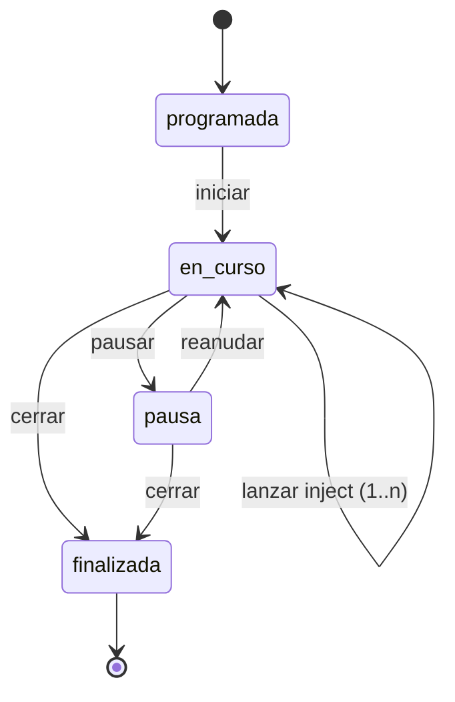
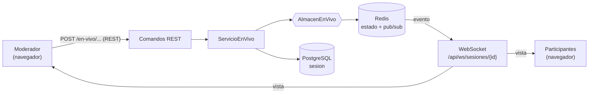

# Motor en tiempo real (PB-07)

Módulo M3, requisito RF-02. El moderador conduce la sesión programada y los
participantes la siguen en vivo desde su dispositivo. Pantallas según los
prototipos P-05 (panel del moderador, Figura 20) y P-04 (vista del
participante, Figura 19); el progreso por participante y las respuestas llegan
con PB-08, PB-09 y PB-11.

## Flujo

- **Fases = injects.** La fase 0 es la apertura (todavía no se lanzó ninguno); el
  moderador lanza los injects en orden hasta el último.
- **Pausa.** No se pueden lanzar injects y el tiempo transcurrido no corre.
- **Cerrar.** La sesión queda `finalizada` en PostgreSQL con su hora de inicio,
  de fin y el último inject; el estado en Redis se borra.

## Arquitectura

- **Comandos por REST, estado por WebSocket.** Los comandos (`iniciar`,
  `lanzar-inject`, `pausar`, `reanudar`, `cerrar`) usan la misma autenticación
  y permisos que el resto de la API. El WebSocket es de **solo recepción**: el
  participante no puede cambiar el estado de la sesión.
- **Dominio** (`app/domain/en_vivo.py`): `EstadoEnVivo` (fase, pausa, tiempo,
  versión) y `EventoEnVivo`. `SesionTabletop.iniciar()` y `finalizar()` aplican
  las transiciones de la sesión.
- **Puertos** (`app/ports/en_vivo.py`): `AlmacenEnVivo` (estado, conexiones y
  publicación; usado por los comandos, código síncrono) y `SuscriptorEnVivo`
  (eventos para cada WebSocket, código asíncrono).
- **Adaptadores** (`app/adapters/outbound/en_vivo/`): `EnVivoRedis` en los
  servidores y `EnVivoEnMemoria` para pruebas, CI y desarrollo sin Redis. Se
  elige por la variable `REDIS_URL` (una instancia por proceso).

## Redis

| Clave | Contenido |
|---|---|
| `nodovip:sesion:{id}:estado` | JSON del `EstadoEnVivo` (expira a las 24 h) |
| `nodovip:sesion:{id}:conectados` | hash usuario → conexiones abiertas (varias pestañas cuentan una vez) |
| `nodovip:sesion:{id}:eventos` | canal pub/sub hacia todos los WebSocket de la sesión, en cualquier proceso |

Cada sesión usa sus propias claves, lo que aísla las sesiones simultáneas
(RNF-04). **PostgreSQL es la fuente de verdad**: cada inject lanzado se refleja
en `sesion.inject_actual`, de modo que si Redis pierde el estado, el servicio lo
reconstruye desde la base al siguiente comando o conexión (RNF-05).

## WebSocket

`ws(s)://<host>/api/ws/sesiones/{id}`, autenticado con la cookie de sesión.

1. Solo se aceptan el **moderador dueño** de la sesión y los **participantes
   invitados** a una sesión programada o en curso.
2. Al conectarse, el servidor se suscribe al canal y **recién entonces** envía
   la foto completa del estado (`{"tipo": "estado", "vista": {...}}`). Así no se
   pierden eventos y quien se reconecta recupera la sesión donde va.
3. Cada comando y cada (des)conexión generan un mensaje con la vista
   actualizada. La vista lleva `version`: el cliente ignora mensajes viejos.
4. El moderador recibe además la lista de usuarios conectados; el participante,
   solo el número.

| Código de cierre | Significado | ¿Reintenta el cliente? |
|---|---|---|
| 1000 | La sesión terminó | No |
| 4401 | Sin sesión iniciada | No |
| 4403 | El rol no puede seguir sesiones | No |
| 4404 | Sesión inexistente o sin invitación | No |
| otro | Corte de red, reinicio del servidor | Sí, con espera creciente (0,5 s a 5 s) |

**Detalles de implementación**

- El WebSocket no retiene una conexión de PostgreSQL: carga la sesión al inicio
  y la libera (puede durar horas).
- Las tareas del WebSocket usan un *task group* de AnyIO; el registro de la
  desconexión está protegido para que ocurra aunque el servidor cancele la
  conexión.
- NGINX tiene una ruta propia `/api/ws/` con las cabeceras `Upgrade` y
  `Connection` y 1 h de espera (una sesión puede pasar minutos sin mensajes).
- El frontend cierra el socket en `pagehide` y reconecta en `pageshow`: si no,
  Chrome guarda la página en su caché de navegación con el socket abierto y la
  persona seguiría figurando como conectada.

## Endpoints

| Método | Ruta | Permiso | Descripción |
|---|---|---|---|
| GET | `/api/sesiones/{id}/en-vivo` | `sesiones:conducir` | Vista actual (moderador dueño) |
| POST | `/api/sesiones/{id}/en-vivo/iniciar` | `sesiones:conducir` | Programada → en curso |
| POST | `/api/sesiones/{id}/en-vivo/lanzar-inject` | `sesiones:conducir` | Siguiente inject (422 en pausa o si no quedan) |
| POST | `/api/sesiones/{id}/en-vivo/pausar` | `sesiones:conducir` | Pausa el tiempo |
| POST | `/api/sesiones/{id}/en-vivo/reanudar` | `sesiones:conducir` | Reanuda |
| POST | `/api/sesiones/{id}/en-vivo/cerrar` | `sesiones:conducir` | Finaliza y persiste |
| WS | `/api/ws/sesiones/{id}` | moderador dueño o participante invitado | Estado en vivo |

## Modelo de datos (migración 0006)

Columnas nuevas en `sesion`: `iniciada_en` y `finalizada_en` (`timestamptz`) e
`inject_actual` (`smallint`, CHECK ≥ 0, por defecto 0).

## Frontend

- **Panel del moderador** (`/sesiones/{id}/conducir`): tiempo transcurrido,
  participantes conectados, inject actual, lista de participantes con su
  conexión y controles (iniciar, lanzar inject, pausar/reanudar, cerrar).
  Desde *Mis tabletops*, botón **Conducir**.
- **Sala del participante** (`/mis-sesiones/{id}/en-vivo`): rol, avance, tiempo
  y narrativa del inject actual; avisos de espera, pausa, reconexión y fin.
  Desde *Mi sesión*, botón **Entrar a la sala**.
- `useEnVivo` (`src/lib/useEnVivo.ts`): conexión, reconexión y cronómetro local
  entre mensajes.

## Pruebas

- `tests/test_en_vivo_dominio.py`: fases, pausa y tiempo, cierre, serialización.
- `tests/test_api_en_vivo.py`: comandos y permisos, reglas (422), reconstrucción
  si Redis se pierde, WebSocket (rechazos, latencia < 3 s, reconexión,
  presencia, cierre).
- `tests/test_en_vivo_redis.py`: adaptador contra Redis real (requiere
  `TEST_REDIS_URL`, usa la base 1).
- `frontend/src/pages/EnVivo.test.tsx`: sala y panel con un WebSocket simulado
  (reconexión, cierre definitivo, bfcache, mensajes viejos, comandos).

Prueba de punta a punta contra la aplicación real (NGINX + Redis + PostgreSQL):
el inject llegó al participante en 27–34 ms.

# Panel de control del moderador (PB-11)

El panel `/sesiones/:id/conducir` sigue el prototipo **P-05 (Figura 20 del
documento)** y muestra el progreso de la sesión en tiempo real, sin recargar:

- **Métricas:** tiempo transcurrido, participantes conectados, inject actual y
  respuestas recibidas sobre las esperadas (en naranja, como el prototipo).
- **Progreso por participante — Inject N** (columna izquierda):
  - nombre, rol y conexión de cada participante;
  - barra con el % de sus tareas lanzadas que ya respondió;
  - estado: *Respondido* (verde), *En progreso* (azul), *Sin respuesta* (rojo) o
    *Sin tareas aún* (gris).
- **Control de sesión** (columna derecha):
  - inject actual con "Lanzado hace mm:ss minutos";
  - comandos de PB-07 (lanzar inject, pausar, reanudar, cerrar);
  - **Respuestas recientes:** las 5 últimas con participante — rol, hora,
    extracto de la respuesta (texto u opciones elegidas), inject y puntaje.
- **Avance por rol** e **Injects**, debajo. No están en el dibujo, pero el ticket
  pide respuestas pendientes por rol e injects lanzados:
  - por rol: conectados, respuestas recibidas sobre esperadas y puntaje;
  - injects: lanzados, en curso y pendientes, con su minuto sugerido.

## Actualización en tiempo real

1. Al guardar una respuesta, `ServicioRespuestas.responder` publica un evento
   `respuesta` en el canal de la sesión (Redis pub/sub). Al ajustar un puntaje
   (PB-10), `ServicioRegistroRespuestas.ajustar` publica un evento `ajuste`.
2. El WebSocket reenvía ambos **solo al moderador**, como `{"tipo": "respuesta"}`
   o `{"tipo": "ajuste"}`, sin datos. Los participantes no los reciben: no saben
   cuándo responden los demás ni cuándo se ajusta un puntaje. Ninguno de los dos
   altera la vista en curso ni la lista de conectados (antes de PC-23, un evento
   que no fuera "suscrito"/"respuesta"/"estado" caía por error en la rama de
   presencia y vaciaba esa lista; ahora esa rama solo se activa con
   `evento.tipo == "presencia"` y cualquier otro tipo se ignora).
3. El panel cuenta esos avisos (`useEnVivo().avisosRespuesta`) y vuelve a pedir
   `GET /api/sesiones/{id}/puntajes` y `GET /api/sesiones/{id}/respuestas`.
   También recarga al cambiar el inject o el estado.
4. `useGetVigente` mantiene los datos anteriores hasta que llegan los nuevos, para
   que el panel no parpadee.
5. **Robustez:** si Redis falla al publicar, la respuesta o el ajuste ya
   guardados en PostgreSQL de todas formas devuelven éxito a quien los hizo; el
   aviso en vivo es una mejora, no una garantía (`app/application/respuestas.py`,
   función `_avisar`).

No hay endpoints nuevos: el panel reutiliza los de PB-09 y PB-10. El leaderboard
del Observador y el Administrador (PB-12, `docs/leaderboard.md`) reutiliza este
mismo evento `ajuste` y el `respuesta`.

## Monitoreo de varias sesiones a la vez (PC-24)

El Administrador puede mirar cualquier sesión `EN_CURSO` en un **modo de
solo lectura**, sin aparecer como un participante más: su conexión por
WebSocket (`/api/ws/monitoreo/{id}`) nunca llama a
`AlmacenEnVivo.conectar`, así que no entra en la lista de `conectados` ni en
el contador que ven el moderador y los demás participantes — solo mira.
También hay un límite configurable (`MAX_SESIONES_ACTIVAS`, 10 por defecto)
de cuántas sesiones pueden estar `EN_CURSO` a la vez, que `iniciar()` hace
cumplir con un advisory lock de PostgreSQL. Detalle completo en
`docs/monitoreo.md`.

**Latencia medida** (app real: NGINX, Redis, PostgreSQL): desde que el
participante envía la respuesta hasta que el aviso llega al moderador, **22 a 27
ms**. El requisito es ≤ 3 s.

## Pruebas de PB-11

- `tests/test_api_respuestas.py`: el moderador recibe `{"tipo": "respuesta"}` y
  el participante no (se ejecutó 15 veces seguidas sin fallos); el moderador
  recibe `{"tipo": "ajuste"}` sin que se vacíe su lista de conectados, y el
  participante tampoco lo recibe; `responder` y `ajustar` devuelven éxito
  aunque `publicar` falle.
- `frontend/src/pages/EnVivo.test.tsx`: el panel muestra el progreso (*Sin
  respuesta*, 0 %) y, al llegar el aviso por WebSocket, recarga y pasa a
  *Respondido* (100 %), con el extracto en *Respuestas recientes* y el contador
  actualizado, sin recargar la página; un aviso de ajuste recarga igual.
