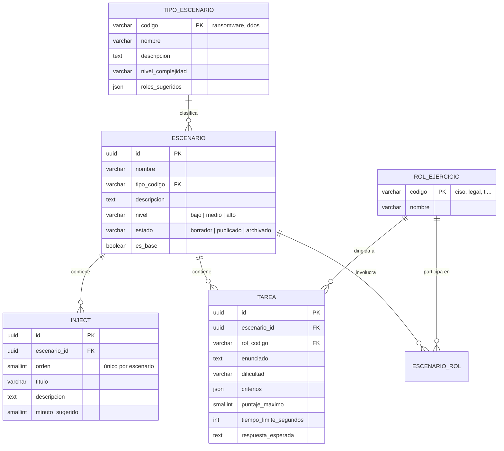

# Biblioteca de escenarios y banco de preguntas (PB-03, PB-04)

Módulo M2, requisito RF-04. Base del diseñador de tabletop (PB-05).

## Modelo de datos



- Los **tipos de escenario** (Tabla 6) y los **roles del ejercicio** son tablas de catálogo: agregar uno nuevo no requiere cambiar código (RNF-08).
- El **banco de preguntas** son todas las tareas de los escenarios, filtrables por tipo de incidente, rol y dificultad (RF-04).
- Los escenarios no se borran: se **archivan**, para no romper sesiones que los usaron.

## Reglas de negocio (RF-04)

| Regla | Cuándo se valida |
|---|---|
| Solo el Administrador crea, edita, publica y archiva escenarios base | Siempre (403 para otros roles) |
| Para publicar: al menos **3 injects** | Al publicar y al editar un escenario ya publicado |
| Para publicar: **tareas para cada rol** involucrado | Al publicar y al editar un escenario ya publicado |
| Las tareas solo pueden ser para roles del escenario | Siempre, incluso en borrador |
| Tipo de escenario y roles deben existir en el catálogo | Siempre |
| El Moderador solo ve escenarios **publicados** | En la biblioteca, el detalle y el banco |

## Endpoints

| Método | Ruta | Permiso | Historia |
|---|---|---|---|
| GET | `/api/catalogos/tipos-escenario` | escenarios:leer | PB-03/04 |
| GET | `/api/catalogos/roles-ejercicio` | escenarios:leer | PB-03/04 |
| GET | `/api/escenarios?q=&tipo=&nivel=&rol=&estado=` | escenarios:leer | PB-04 |
| GET | `/api/escenarios/{id}` | escenarios:leer | PB-04 |
| GET | `/api/banco-preguntas?tipo=&rol=&dificultad=` | escenarios:leer | PB-04 |
| POST | `/api/escenarios` | escenarios:gestionar | PB-03 |
| PUT | `/api/escenarios/{id}` | escenarios:gestionar | PB-03 |
| POST | `/api/escenarios/{id}/publicar` | escenarios:gestionar | PB-03 |
| POST | `/api/escenarios/{id}/archivar` | escenarios:gestionar | PB-03 |

Respuestas de error: `401` sin usuario, `403` sin permiso, `404` no existe (o no visible para el rol), `422` datos inválidos o regla de negocio incumplida (con la lista de `errores`).

## Autenticación temporal (hasta PB-01)

Mientras no exista el login, en los ambientes `local` y `test` el rol se envía en la cabecera `X-Rol-Debug`. En cualquier otro ambiente la API responde 401. PB-01 reemplaza esto por el token sin cambiar los endpoints.

```bash
curl -H "X-Rol-Debug: moderador" "http://localhost:8080/api/escenarios?tipo=ransomware"
```

## Datos de ejemplo

```bash
docker compose exec backend python -m app.seed_escenarios
```

Carga y publica "Ransomware en servidores de archivos" (4 injects, 5 tareas, 5 roles). Contenido ficticio.
