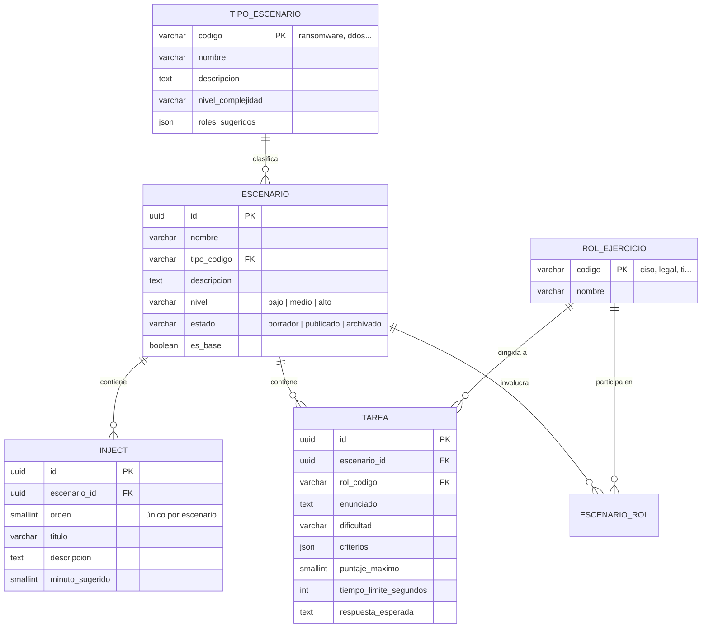

# Biblioteca de escenarios y banco de preguntas (PB-03, PB-04)

Módulo M2, requisito RF-04. Base del diseñador de tabletop (PB-05).

## Modelo de datos



- Los **tipos de escenario** (Tabla 6) y los **roles del ejercicio** son tablas de catálogo: agregar uno nuevo no requiere cambiar código (RNF-08).
- El **banco de preguntas** son todas las tareas de los escenarios, filtrables por tipo de incidente, rol y dificultad (RF-04).
- Los escenarios no se borran: se **archivan**, para no romper sesiones que los usaron.

## Reglas de negocio (RF-04)

| Regla | Cuándo se valida |
|---|---|
| Solo el Administrador crea, edita, publica y archiva escenarios base | Siempre (403 para otros roles) |
| Para publicar: al menos **3 injects** | Al publicar y al editar un escenario ya publicado |
| Para publicar: **tareas para cada rol** involucrado | Al publicar y al editar un escenario ya publicado |
| Las tareas solo pueden ser para roles del escenario | Siempre, incluso en borrador |
| Tipo de escenario y roles deben existir en el catálogo | Siempre |
| El Moderador solo ve escenarios **publicados** | En la biblioteca, el detalle y el banco |

## Endpoints

| Método | Ruta | Permiso | Historia |
|---|---|---|---|
| GET | `/api/catalogos/tipos-escenario` | escenarios:leer | PB-03/04 |
| GET | `/api/catalogos/roles-ejercicio` | escenarios:leer | PB-03/04 |
| GET | `/api/escenarios?q=&tipo=&nivel=&rol=&estado=` | escenarios:leer | PB-04 |
| GET | `/api/escenarios/{id}` | escenarios:leer | PB-04 |
| GET | `/api/banco-preguntas?tipo=&rol=&dificultad=` | escenarios:leer | PB-04 |
| POST | `/api/escenarios` | escenarios:gestionar | PB-03 |
| PUT | `/api/escenarios/{id}` | escenarios:gestionar | PB-03 |
| POST | `/api/escenarios/{id}/publicar` | escenarios:gestionar | PB-03 |
| POST | `/api/escenarios/{id}/archivar` | escenarios:gestionar | PB-03 |

Respuestas de error: `401` sin usuario, `403` sin permiso, `404` no existe (o no visible para el rol), `422` datos inválidos o regla de negocio incumplida (con la lista de `errores`).

## Autenticación

Los endpoints usan la sesión de PB-01 (cookie `nodovip_sesion`). Ver `docs/autenticacion.md`.

```bash
curl -c sesion.txt -H "Content-Type: application/json"   -d '{"correo":"moderador@ejemplo.test","contrasena":"..."}'   http://localhost:8080/api/auth/login
curl -b sesion.txt "http://localhost:8080/api/escenarios?tipo=ransomware"
```

## Tipo de pregunta e inject de cada tarea (PC-46)

Migración `0013`. Cada tarea del escenario tiene:

| Campo | Descripción |
|---|---|
| `tipo` | `texto_libre`: se evalúa con `criterios` (al menos uno para publicar). `seleccion_multiple`: se evalúa con `opciones` (al menos 2 y una correcta para publicar). |
| `opciones` | Lista JSON `{texto, correcta}`. Una tarea de texto libre no lleva opciones (regla de consistencia). |
| `inject_orden` | En qué inject se hace la pregunta. Si falta, la sesión reparte las tareas de cada rol en orden, como antes. Si apunta a un inject que no existe, devuelve 422. |

`TipoTarea`, `OpcionRespuesta` y la validación `errores_de_tarea()` viven en
`domain/escenarios.py` y los comparte la sesión. `SesionTabletop.desde_escenario`
copia el tipo y las opciones y respeta el inject de cada pregunta.

En el frontend, el formulario del escenario tiene los campos "Se pregunta en" y
"Tipo de respuesta", y usa el editor de opciones compartido con el diseñador
(`components/EditorOpciones.tsx`). El detalle del escenario muestra el inject,
el tipo y las opciones, con la correcta marcada.

## Catálogo de escenarios profesionales (PC-46)

`app/catalogo_escenarios/` tiene un módulo por escenario y los atajos de
`_base.py` (`inject`, `correo`, `alerta`, `texto`, `seleccion`…).

| Escenario | Tipo | Organización ficticia | Roles |
|---|---|---|---|
| Ransomware en servidores de archivos | ransomware | Comercial Andina S.A. | CISO, Comunicaciones, Director Ejecutivo, Legal, TI |
| Phishing al gerente financiero y fraude de transferencia | phishing_dirigido | Seguros Cordillera Azul S.A. | CISO, TI, Director Ejecutivo, Legal, RR. HH. |
| Fuga de datos de pacientes en el portal de citas | data_breach | Clínica Integral Los Alisos | Legal, CISO, TI, Relaciones Públicas, Atención al Cliente |
| Caída de la banca en línea por DDoS en día de pago | ddos | Cooperativa Nevado Plata | TI, Operaciones, Atención al Cliente, Comunicaciones, Director Ejecutivo |
| Amenaza interna: extracción de la cartera de clientes | insider_threat | Distribuidora Ventisquero S.A. | CISO, TI, RR. HH., Legal, Dirección |
| Actualización maliciosa del software de facturación | cadena_suministro | Logística Páramo Sur S.A. / FacturaPlus | TI, CISO, Legal, Dirección, Operaciones |

Cada escenario:

- tiene **4 injects** que recorren las fases de NIST SP 800-61: detección y
  análisis → contención → erradicación y recuperación → actividades
  posteriores. Cada inject trae una **evidencia simulada** (PC-44), con al
  menos 3 tipos distintos por escenario;
- tiene **7 u 8 preguntas** ubicadas en su inject, al menos una por rol y por
  inject, que combinan **texto libre** (3 criterios evaluables) con **selección
  múltiple** (al menos 3 opciones y una correcta);
- incluye obligaciones de notificación según la **Ley Orgánica de Protección
  de Datos Personales del Ecuador** cuando hay datos personales en juego;
- es **100 % ficticio**: organizaciones y personas inventadas, y correos y URL
  solo con dominios `.test` o `.example`. Lo verifica
  `tests/test_catalogo_escenarios.py`.

### Carga

```bash
docker compose exec backend python -m app.seed_escenarios               # crea los que falten
docker compose exec backend python -m app.seed_escenarios --actualizar  # además reemplaza los existentes
```

La carga es idempotente: no duplica escenarios (los identifica por nombre) y
los deja publicados. `--actualizar` reemplaza el contenido de los que ya
existen; las sesiones creadas antes no cambian, porque copiaron el contenido al
crearse.
