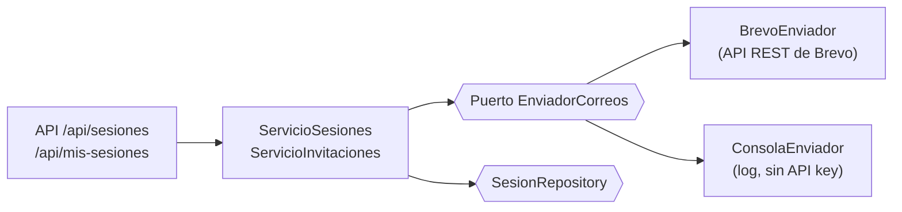

# Invitaciones y acceso del participante (PB-06)

Módulo M1, requisitos RF-01, RF-05 y RNF-06, caso de uso CU-03.6 (paso 6 del
diseñador de tabletop). Complementa `docs/sesiones.md`.

## Flujo

1. El moderador **programa** la sesión (paso 5). En ese momento se envía un
   correo a cada participante con su rol, la fecha, la duración y un enlace a
   `/mis-sesiones/{id}`.
2. El participante abre el enlace. Si no inició sesión, pasa por el login y
   vuelve a la misma página.
3. Ve la sesión, **su rol**, el escenario y el moderador, y pulsa
   **Confirmar asistencia**: la invitación queda *aceptada*.
4. El moderador sigue el estado en el **paso 6** y reenvía las invitaciones
   pendientes o que fallaron.

## Estados de la invitación

| Estado | Significado |
|---|---|
| `pendiente` | Todavía no se envió (la sesión es borrador, o el participante se agregó después de programarla) |
| `enviada` | Brevo aceptó el correo (`invitacion_enviada_en`) |
| `fallida` | Brevo lo rechazó o no respondió, o la cuenta está desactivada (`invitacion_error`) |
| `aceptada` | El participante confirmó su asistencia (`invitacion_aceptada_en`) |

- Un fallo con un participante **no detiene** a los demás: queda registrado y se
  reenvía desde el paso 6.
- Al editar una sesión programada, quien **sigue con el mismo rol** conserva su
  invitación; un participante nuevo o con otro rol queda *pendiente*.
- Una invitación *aceptada* no vuelve atrás aunque se reenvíe.

## Modelo de datos (migración 0005)

Columnas nuevas en `sesion_participante`:

| Columna | Tipo |
|---|---|
| `invitacion` | `varchar(15)`, CHECK en los 4 estados, por defecto `pendiente` |
| `invitacion_enviada_en` | `timestamptz` NULL |
| `invitacion_aceptada_en` | `timestamptz` NULL |
| `invitacion_error` | `varchar(300)` NULL (último error del proveedor) |

## Arquitectura (hexagonal)

- **Puerto** `app/ports/correo.py`: `EnviadorCorreos.enviar(MensajeCorreo)`; si
  falla lanza `ErrorEnvioCorreo`.
- **Brevo** `app/adapters/outbound/correo/brevo.py`: `POST
  https://api.brevo.com/v3/smtp/email` con la cabecera `api-key`, usando
  `urllib` (sin dependencias nuevas) y 10 s de espera máxima.
- **Consola** `app/adapters/outbound/correo/consola.py`: si no hay
  `BREVO_API_KEY`, el correo se escribe en el log (`docker compose logs -f
  backend`). Fuera de local/test se registra una advertencia.
- **Contenido** `app/application/invitaciones.py` (`mensaje_invitacion`):
  versión HTML y texto. Todos los datos de usuarios se **escapan** antes de ir al
  HTML. La fecha se muestra en hora de Ecuador (UTC−5, sin horario de verano).

## Configuración

| Variable | Uso |
|---|---|
| `BREVO_API_KEY` | Clave de la API de Brevo (*SMTP & API → API Keys*). Vacía = modo consola |
| `CORREO_REMITENTE` | Remitente **verificado** en Brevo (*Senders & IP*) |
| `CORREO_REMITENTE_NOMBRE` | Nombre visible del remitente (por defecto "NODOVIP Tabletop") |
| `APP_URL` | Dirección pública del frontend para el enlace (por defecto `http://localhost:8080`) |

La clave va solo en `.env` (nunca en el repositorio). En Staging, `APP_URL` debe
ser la dirección de la VM.

## Endpoints

| Método | Ruta | Permiso | Descripción |
|---|---|---|---|
| POST | `/api/sesiones/{id}/programar` | `sesiones:disenar` | Programa y envía las invitaciones |
| POST | `/api/sesiones/{id}/invitaciones` | `sesiones:disenar` | Reenvía las pendientes o fallidas (422 si es borrador) |
| GET | `/api/mis-sesiones` | `sesiones:participar` | Sesiones programadas o en curso a las que fue invitado |
| GET | `/api/mis-sesiones/{id}` | `sesiones:participar` | Detalle: su rol, escenario, moderador, fecha |
| POST | `/api/mis-sesiones/{id}/aceptar` | `sesiones:participar` | Confirma la asistencia |

- Una sesión a la que el usuario **no fue invitado**, o que todavía es borrador,
  responde **404** (no se revela que existe).
- La vista del participante **no incluye** tareas, opciones correctas ni
  criterios: los recibe en vivo cuando el moderador inicia la sesión (PB-08).
- En `GET /api/sesiones/{id}` cada participante incluye `invitacion`,
  `invitacion_enviada_en`, `invitacion_aceptada_en` e `invitacion_error`.

## Frontend

- **Mis sesiones** (`/mis-sesiones`): menú del participante y su página de
  inicio. Tarjetas con rol, fecha y estado de la invitación.
- **Mi sesión** (`/mis-sesiones/{id}`): destino del enlace del correo. Rol
  destacado, datos de la sesión y botón *Confirmar asistencia*. Diseñada para
  móvil (RNF-06/07).
- **Paso 6 del diseñador**: tabla de participantes con el estado de su
  invitación y botón *Enviar N pendiente(s)*. Al programar, el asistente pasa
  solo a este paso.

## Pruebas

- `tests/test_invitaciones.py`: envío al programar, fallos de Brevo, reenvío,
  cuentas desactivadas, conservación al editar, visibilidad, aceptación y
  escapado del HTML.
- `tests/test_api_mis_sesiones.py`: permisos (401/403/404), estado visible para
  el moderador, reenvío y aceptación por API.
- `tests/test_correo_brevo.py`: petición a Brevo (URL, cabecera, cuerpo),
  errores HTTP y de conexión, elección del adaptador.
- `tests/test_repositorio_sesiones_pg.py`: las columnas nuevas en PostgreSQL.
- `frontend/src/pages/MiSesionPage.test.tsx` y el paso 6 en
  `DisenadorPage.test.tsx`.
