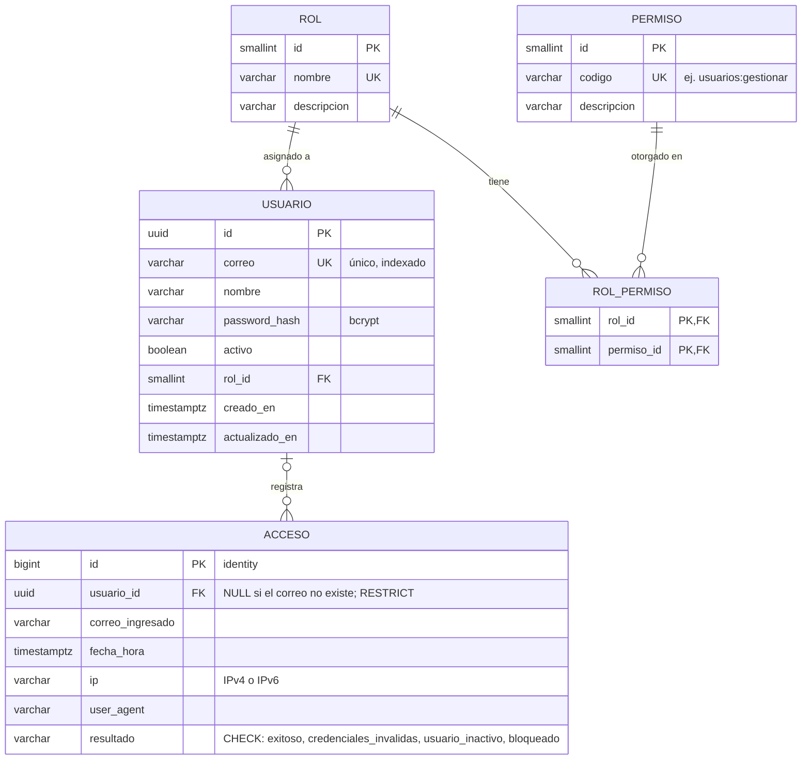

# Modelo de datos — Usuarios, roles, permisos y accesos (PC-11, PC-12)

Base de PB-01 (autenticación y acceso por rol), PB-02 (gestión de usuarios) y del C4 Nivel 4 de la sección 7.1.

## Diagrama Entidad–Relación

## Decisiones de diseño

- **Un rol por usuario** (relación N:1). PB-02 pide asignar y cambiar "el rol" de cada usuario.
- **Permisos por rol** (N:M en `rol_permiso`). Permite aplicar mínimo privilegio (RNF-01) sin cambiar código: se agregan filas, no `if` por rol.
- **UUID en `usuario.id`**: los identificadores no son predecibles en URLs ni en tokens.
- **`correo` único** (la restricción UNIQUE crea su índice): es el dato de login.
- **`password_hash`**: nunca se guarda la contraseña en texto plano; se usa bcrypt (RNF-02).
- **`activo`** en lugar de borrar: un usuario desactivado conserva su historial para auditoría.
- **Fechas con zona horaria** (`timestamptz`) para trazabilidad.

## Matriz de roles y permisos (carga inicial)

| Permiso | Administrador | Moderador | Participante | Observador | Analista |
|---|:-:|:-:|:-:|:-:|:-:|
| usuarios:gestionar | ✅ | | | | |
| escenarios:gestionar | ✅ | | | | |
| escenarios:leer | ✅ | ✅ | | | |
| sesiones:disenar | | ✅ | | | |
| sesiones:conducir | | ✅ | | | |
| sesiones:participar | | | ✅ | | |
| sesiones:monitorear | ✅ | | | | |
| leaderboard:ver | ✅ | ✅ | | ✅ | |
| reportes:generar | | | | | ✅ |
| reportes:ver | ✅ | ✅ | | | ✅ |

La matriz vive en dos lugares que deben coincidir: `backend/app/domain/usuarios.py` (`PERMISOS_POR_ROL`) y la migración `0001`. Si cambia, se crea una migración nueva.

## Historial de accesos (PB-01, migración 0003)

- **Una fila por intento de login**, exitoso o no (RNF-01). Ver `docs/autenticacion.md`.
- **`usuario_id` nullable:** también se registran intentos con correos que no existen.
- **FK `RESTRICT`:** una cuenta con accesos no se puede eliminar, solo desactivar.
- **Índices** `(usuario_id, fecha_hora DESC)`, `(correo_ingresado, fecha_hora DESC)`
  (para el bloqueo por intentos fallidos) y `(fecha_hora DESC)` (para el listado).
