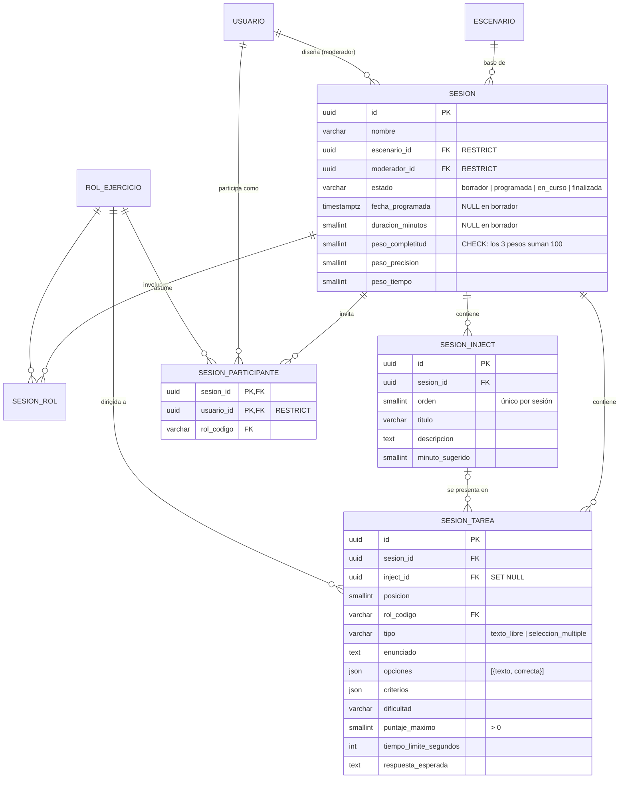

# Diseñador de tabletop (PB-05)

Módulo M1, requisito RF-01, casos de uso CU-03.1 a CU-03.5. Pantalla según el
prototipo P-03 "Diseñador de tabletop" (Figura 18 del documento). El paso 6
(CU-03.6, enviar invitaciones) llega con PB-06.

Una **sesión tabletop** es la instancia que el Moderador diseña a partir de un
escenario publicado. Copia sus roles, injects y tareas: el Moderador puede
ajustarlos sin modificar el escenario de la biblioteca. La sesión queda lista
para que el motor en tiempo real (PB-07) la inicie.

## Modelo de datos (migración 0004)



- **Copia, no referencia:** las tareas e injects de la sesión son filas propias.
  Editar la sesión no cambia el escenario, y editar el escenario después no
  cambia sesiones ya diseñadas (trazabilidad, RF-07).
- **Tarea → inject:** cada tarea se presenta durante un inject (prototipo:
  "Agregar tarea al inject"). Al crear la sesión, las tareas de cada rol se
  reparten en orden: la primera en el inject 1, la segunda en el 2, etc.
- **Tipos de tarea:** *texto libre* se evalúa con los criterios; *selección
  múltiple* con las opciones marcadas como correctas (PB-10).
- **Pesos (RF-03):** completitud, precisión y tiempo, a nivel de sesión. Suman
  100 (CHECK en la base). Por defecto 40 / 40 / 20.
- **Cliente (PB-14):** organización opcional (máx. 120 caracteres, se normalizan
  los espacios). Se edita en el paso "Programar"; el reporte de brechas compara con
  las sesiones anteriores del mismo cliente (`docs/reportes.md`).
- **Puntaje máximo total:** no se guarda; se calcula como la suma de los
  puntajes de las tareas (RF-01: "debe calcularse automáticamente").
- **FK RESTRICT** a `escenario` y `usuario`: un escenario o una cuenta usados en
  una sesión no se pueden borrar (solo archivar o desactivar). Al eliminar un
  usuario asignado, la API responde 409 como en PB-02.

## Reglas de negocio (RF-01)

Siempre, incluso en borrador (422 si no se cumplen):

- Nombre no vacío, sin roles repetidos, pesos que sumen 100.
- Las tareas y los participantes solo usan roles de la sesión.
- Las tareas apuntan a injects de la sesión; texto libre no lleva opciones.
- Un participante tiene un solo rol en la sesión.
- Los participantes deben ser usuarios **activos con rol Participante**.
- Los roles deben existir en el catálogo `rol_ejercicio`.

Para **programar** (borrador → programada):

- Al menos un rol y un inject; tareas para cada rol, todas ubicadas en un inject.
- Texto libre: al menos un criterio. Selección múltiple: ≥ 2 opciones y al
  menos una correcta.
- Al menos un participante por rol.
- Fecha y hora futuras, y una duración.

Una sesión programada se puede seguir editando, pero debe seguir cumpliendo
estas reglas. En curso o finalizada ya no se edita. Solo se eliminan borradores.

## Endpoints

Todos requieren el permiso `sesiones:disenar` (solo Moderador). Cada moderador
ve únicamente sus sesiones: las de otro responden 404.

| Método | Ruta | Descripción |
|---|---|---|
| GET | `/api/sesiones` | Sesiones del moderador, la más reciente primero |
| POST | `/api/sesiones` | Crea un borrador desde `{escenario_id, nombre?}` (escenario publicado) |
| GET | `/api/sesiones/{id}` | Detalle, con `puntaje_maximo_total` y `pendientes_para_programar` |
| PUT | `/api/sesiones/{id}` | Guarda el diseño completo (pasos 2 a 5) |
| POST | `/api/sesiones/{id}/programar` | Borrador → programada |
| DELETE | `/api/sesiones/{id}` | Elimina un borrador (204) |
| GET | `/api/sesiones/participantes-disponibles` | Participantes activos: solo id, nombre y correo |

En el `PUT`, el cliente envía el `id` de cada inject (también de los nuevos,
generado con `crypto.randomUUID()`) para que las tareas puedan apuntar a él en
el mismo request. El orden de los injects es su posición en la lista. Las fechas
deben llevar zona horaria (ISO 8601); sin ella la API responde 422.

## Frontend

- **Mis tabletops** (`/sesiones`): lista con estado, fecha, participantes y
  puntaje; continuar o eliminar borradores.
- **Paso 1** (`/sesiones/nueva`): escenarios publicados. También se llega desde
  el botón "Usar como base" del detalle del escenario.
- **Pasos 2 a 6** (`/sesiones/{id}/disenar?paso=N`): roles y participantes,
  injects y tareas por rol, pesos y puntajes, fecha y duración, invitaciones
  (PB-06). Al cambiar de paso se guarda el borrador; si el backend rechaza el
  diseño, se muestran los errores y no se avanza. Los pasos que ya cumplen sus
  reglas se marcan con ✓.

## Datos de prueba

`app.seed_usuarios_demo` crea una moderadora, una observadora (PB-12) y cinco
participantes ficticios (`@demo.nodovip.test`) con la contraseña de la
variable `DEMO_CONTRASENA`:

```powershell
docker compose exec -e DEMO_CONTRASENA=<contraseña> backend python -m app.seed_usuarios_demo
```

## Pruebas

- `tests/test_sesiones_dominio.py`: reglas de dominio (sin base de datos).
- `tests/test_api_sesiones.py`: API con repositorios en memoria (permisos,
  propiedad, validaciones, programar, eliminar).
- `tests/test_repositorio_sesiones_pg.py`: integración con PostgreSQL (requiere
  `TEST_DATABASE_URL`; borra sesiones y escenarios).
- `frontend/src/pages/DisenadorPage.test.tsx`: asistente con la API simulada.
